# Diseño y desarrollo del minicompilador clínico

## 1. Análisis

Se simula la supervisión técnica de equipos ficticios de una clínica. El lenguaje codificado asigna parámetros, evalúa reglas y solicita avisos operativos. No diagnostica pacientes ni controla hardware.

El analizador de citas previo reconocía datos ya interpretables. Esta evolución incorpora traducción a código intermedio y una máquina de pila independiente. Las fuentes y pruebas anteriores permanecen en `historico/citas-medicas`.

La metodología en cascada separa análisis del lenguaje, diseño formal, implementación y pruebas. No se presentan estadísticas de una clínica ni se reutilizan como evidencia los antecedentes sobre citas. La revisión de literatura y la formulación investigativa deben actualizarse en el informe final.

### Lenguaje y proceso

Entrada codificada → léxico → SLR(1) → semántica → código de pila → simulación → JSON.

```text
CARGAR S01 = 28;
CARGAR S02 = 15;
SI S01 > 26 Y S02 < 20 ENTONCES AVISAR A01;
```

Se exige al menos una CARGA y una REGLA; cargas antes de reglas, terminación `;`, mayúsculas exactas, códigos conocidos, cargas únicas y referencias cargadas. Cualquier error impide toda ejecución. Una condición falsa es válida.

| Token principal | Expresión regular |
|---|---|
| SENSOR | `S[0-9][0-9]` |
| ACCION | `A[0-9][0-9]` |
| NUMERO | `[0-9]+` |
| COMPARADOR | `<=\|>=\|==\|!=\|<\|>` |
| IGUAL | `=` |

Literales adicionales: CARGAR, SI, Y, ENTONCES, AVISAR y PUNTO_Y_COMA (`;`). No forman parte de las cinco familias seleccionables, pero sí del inventario léxico.

Los códigos S99 y A99 son lexemas válidos y semánticamente desconocidos. S011, SIEMPRE y ! aislado no se fragmentan para aceptarlos.

### Diccionario semántico

- S01: Temperatura simulada del equipo, entero 0–50.
- S02: Batería simulada del equipo (%), entero 0–100.
- A01: Revisión técnica simulada.
- A02: Mantenimiento preventivo simulado.

Rangos ficticios académicos, sin significado clínico real. Se comprueban cargas y umbrales. Los ceros iniciales son válidos y se traducen a un entero decimal.

## 2. Diseño

### Arquitectura

`automatas.py`/`motor.js` reconocen las cinco familias mediante construcciones directas; conservan Thompson como motor general. `slr.py`/`slr.js` calculan FIRST/FOLLOW, cerraduras LR(0), ACTION/GOTO y reducciones. `clinica.py`/`clinica.js` implementan el nuevo lenguaje, sus atributos y traducción. `simulador.py`/`simulador.js` ejecutan únicamente código de pila. Flask conserva rutas/TXT; Netlify usa seis scripts locales sin Render.

### Gramática aumentada y tabla SLR(1)

Se calcularon 27 estados LR(0) y 0 conflictos SLR(1). PYC abrevia PUNTO_Y_COMA. La producción aumentada 0 se presenta fuera de P.

0. `P' → P`
1. `P → CARGAS REGLAS`
2. `CARGAS → CARGA CARGAS`
3. `CARGAS → CARGA`
4. `REGLAS → REGLA REGLAS`
5. `REGLAS → REGLA`
6. `CARGA → CARGAR SENSOR IGUAL NUMERO PUNTO_Y_COMA`
7. `REGLA → SI COND ENTONCES AVISAR ACCION PUNTO_Y_COMA`
8. `COND → COMP RESTO`
9. `RESTO → Y COMP RESTO`
10. `RESTO → ε`
11. `COMP → SENSOR COMPARADOR NUMERO`

La evidencia completa generada está en [slr-generado.json](slr-generado.json): items, transiciones, FIRST, FOLLOW y ACTION/GOTO. El árbol, las derivaciones, la traza y los atributos del ejemplo están en [ejemplo-compilado.json](ejemplo-compilado.json).

### Autómatas, quíntuplas y tablas

Un AFD parcial es un caso particular de AFND. Las construcciones directas no inventan diferencias entre ambos. La conversión por subconjuntos y la minimización se ejecutan realmente; el sumidero interno se omite en la representación parcial. Una transición inexistente significa rechazo.

El AFD mínimo de SENSOR tiene cuatro estados bajo la convención de autómata parcial, sin sumidero explícito (δ: Q × Σ ⇀ Q). Esta cifra no describe un AFD total.

### SENSOR

Regex: `S[0-9][0-9]`.

Ejemplos léxicos: S01, S02, S99.

#### AFND (4 estados)

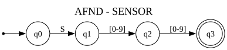

M=(Q, Σ, δ, q₀, F); Q=['q0', 'q1', 'q2', 'q3']; Σ=['0', '1', '2', '3', '4', '5', '6', '7', '8', '9', 'S']; q₀=q0; F=['q3'].

| Estado | [0-9] | S |
|---|---|---|
| →q0 | ∅ | q1 |
| q1 | q2 | ∅ |
| q2 | q3 | ∅ |
| *q3 | ∅ | ∅ |

#### AFD (4 estados)

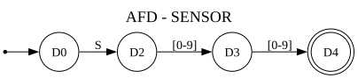

M=(Q, Σ, δ, q₀, F); Q=['D0', 'D2', 'D3', 'D4']; Σ=['0', '1', '2', '3', '4', '5', '6', '7', '8', '9', 'S']; q₀=D0; F=['D4'].

| Estado | [0-9] | S |
|---|---|---|
| →D0 | ∅ | D2 |
| D2 | D3 | ∅ |
| D3 | D4 | ∅ |
| *D4 | ∅ | ∅ |

#### AFD mínimo parcial, sin sumidero explícito (4 estados)

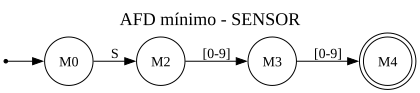

M=(Q, Σ, δ, q₀, F); Q=['M0', 'M2', 'M3', 'M4']; Σ=['0', '1', '2', '3', '4', '5', '6', '7', '8', '9', 'S']; q₀=M0; F=['M4'].

| Estado | [0-9] | S |
|---|---|---|
| →M0 | ∅ | M2 |
| M2 | M3 | ∅ |
| M3 | M4 | ∅ |
| *M4 | ∅ | ∅ |

### ACCION

Regex: `A[0-9][0-9]`.

Ejemplos léxicos: A01, A02, A99.

#### AFND (4 estados)

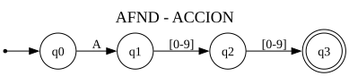

M=(Q, Σ, δ, q₀, F); Q=['q0', 'q1', 'q2', 'q3']; Σ=['0', '1', '2', '3', '4', '5', '6', '7', '8', '9', 'A']; q₀=q0; F=['q3'].

| Estado | [0-9] | A |
|---|---|---|
| →q0 | ∅ | q1 |
| q1 | q2 | ∅ |
| q2 | q3 | ∅ |
| *q3 | ∅ | ∅ |

#### AFD (4 estados)

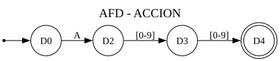

M=(Q, Σ, δ, q₀, F); Q=['D0', 'D2', 'D3', 'D4']; Σ=['0', '1', '2', '3', '4', '5', '6', '7', '8', '9', 'A']; q₀=D0; F=['D4'].

| Estado | [0-9] | A |
|---|---|---|
| →D0 | ∅ | D2 |
| D2 | D3 | ∅ |
| D3 | D4 | ∅ |
| *D4 | ∅ | ∅ |

#### AFD mínimo parcial, sin sumidero explícito (4 estados)

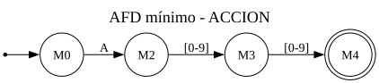

M=(Q, Σ, δ, q₀, F); Q=['M0', 'M2', 'M3', 'M4']; Σ=['0', '1', '2', '3', '4', '5', '6', '7', '8', '9', 'A']; q₀=M0; F=['M4'].

| Estado | [0-9] | A |
|---|---|---|
| →M0 | ∅ | M2 |
| M2 | M3 | ∅ |
| M3 | M4 | ∅ |
| *M4 | ∅ | ∅ |

### NUMERO

Regex: `[0-9]+`.

Ejemplos léxicos: 0, 28, 100.

#### AFND (2 estados)

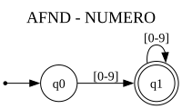

M=(Q, Σ, δ, q₀, F); Q=['q0', 'q1']; Σ=['0', '1', '2', '3', '4', '5', '6', '7', '8', '9']; q₀=q0; F=['q1'].

| Estado | [0-9] |
|---|---|
| →q0 | q1 |
| *q1 | q1 |

#### AFD (2 estados)

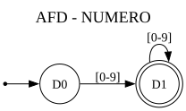

M=(Q, Σ, δ, q₀, F); Q=['D0', 'D1']; Σ=['0', '1', '2', '3', '4', '5', '6', '7', '8', '9']; q₀=D0; F=['D1'].

| Estado | [0-9] |
|---|---|
| →D0 | D1 |
| *D1 | D1 |

#### AFD mínimo parcial, sin sumidero explícito (2 estados)

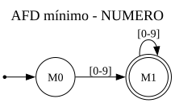

M=(Q, Σ, δ, q₀, F); Q=['M0', 'M1']; Σ=['0', '1', '2', '3', '4', '5', '6', '7', '8', '9']; q₀=M0; F=['M1'].

| Estado | [0-9] |
|---|---|
| →M0 | M1 |
| *M1 | M1 |

### COMPARADOR

Regex: `<=|>=|==|!=|<|>`.

Ejemplos léxicos: <, >, <=, >=, ==, !=.

#### AFND (4 estados)

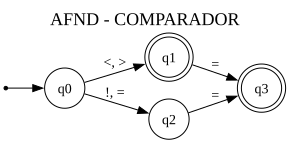

M=(Q, Σ, δ, q₀, F); Q=['q0', 'q1', 'q2', 'q3']; Σ=['!', '<', '=', '>']; q₀=q0; F=['q1', 'q3'].

| Estado | ! | <, > | = |
|---|---|---|---|
| →q0 | q2 | q1 | q2 |
| *q1 | ∅ | ∅ | q3 |
| q2 | ∅ | ∅ | q3 |
| *q3 | ∅ | ∅ | ∅ |

#### AFD (4 estados)

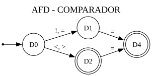

M=(Q, Σ, δ, q₀, F); Q=['D0', 'D1', 'D2', 'D4']; Σ=['!', '<', '=', '>']; q₀=D0; F=['D2', 'D4'].

| Estado | ! | <, > | = |
|---|---|---|---|
| →D0 | D1 | D2 | D1 |
| D1 | ∅ | ∅ | D4 |
| *D2 | ∅ | ∅ | D4 |
| *D4 | ∅ | ∅ | ∅ |

#### AFD mínimo parcial, sin sumidero explícito (4 estados)

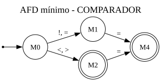

M=(Q, Σ, δ, q₀, F); Q=['M0', 'M1', 'M2', 'M4']; Σ=['!', '<', '=', '>']; q₀=M0; F=['M2', 'M4'].

| Estado | ! | <, > | = |
|---|---|---|---|
| →M0 | M1 | M2 | M1 |
| M1 | ∅ | ∅ | M4 |
| *M2 | ∅ | ∅ | M4 |
| *M4 | ∅ | ∅ | ∅ |

### IGUAL

Regex: `=`.

Ejemplos léxicos: =.

#### AFND (2 estados)

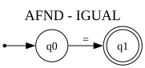

M=(Q, Σ, δ, q₀, F); Q=['q0', 'q1']; Σ=['=']; q₀=q0; F=['q1'].

| Estado | = |
|---|---|
| →q0 | q1 |
| *q1 | ∅ |

#### AFD (2 estados)

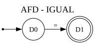

M=(Q, Σ, δ, q₀, F); Q=['D0', 'D1']; Σ=['=']; q₀=D0; F=['D1'].

| Estado | = |
|---|---|
| →D0 | D1 |
| *D1 | ∅ |

#### AFD mínimo parcial, sin sumidero explícito (2 estados)

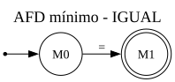

M=(Q, Σ, δ, q₀, F); Q=['M0', 'M1']; Σ=['=']; q₀=M0; F=['M1'].

| Estado | = |
|---|---|
| →M0 | M1 |
| *M1 | ∅ |

## 3. Desarrollo

Las reducciones sintetizan listas ordenadas de cargas, reglas y comparaciones. Solo después de validar todo el programa se emite PUSH/STORE/LOAD, comparadores, JUMP_IF_FALSE, EMIT y LABEL. Cada comparación falsa salta al final de su regla, implementando Y con cortocircuito.

### Código calculado del ejemplo

```text
PUSH 28
STORE S01
PUSH 15
STORE S02
LOAD S01
PUSH 26
GT
JUMP_IF_FALSE L1
LOAD S02
PUSH 20
LT
JUMP_IF_FALSE L1
EMIT A01
LABEL L1
```

### Salida de la ejecución

```json
{
  "estado": "aceptado",
  "avisos": [
    {
      "codigo": "A01",
      "descripcion": "Revisión técnica simulada"
    }
  ]
}
```

## 4. Pruebas y entrega

Las herramientas son unittest, node:test, comparación exhaustiva por producto de autómatas, comparación JSON Python/JavaScript, lectura estructural de SVG y prueba de build limpio con red bloqueada en el frontend. Las comprobaciones reproducibles están implementadas en `test_proyecto.py`, `test_paridad.py`, `test_interfaz_generada.py`, `test_despliegue.py`, `test_cliente.cjs` y `verificar_http.py`, en la raíz del proyecto.

El PowerPoint pide un reporte PDF. La interfaz ofrece imprimir/guardar PDF con el navegador; esta operación y el aspecto en escritorio/móvil requieren revisión manual. No se presenta un DOM simulado como revisión visual.

El documento Word externo no se editó ni se renderizó: este contenido Markdown está preparado para incorporarlo y verificarlo visualmente. No se afirma aprobación formal del docente ni cierre de los requisitos investigativos del informe.
